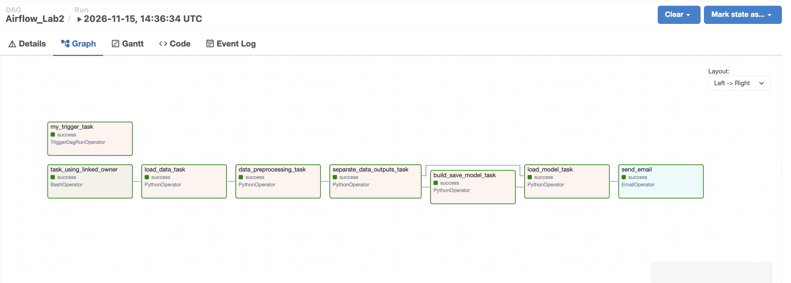
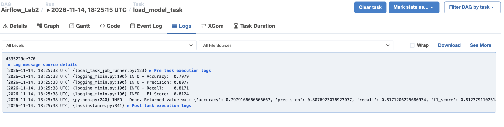
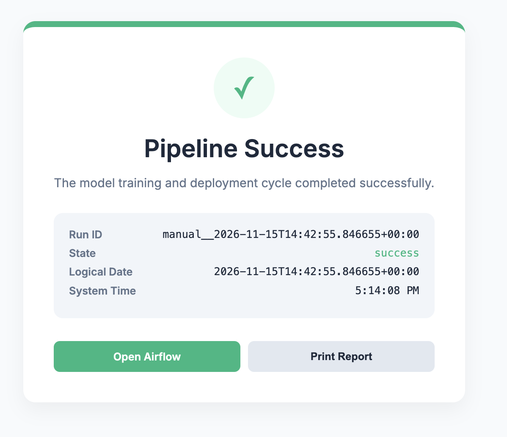

# Airflow Lab 2 — Wine Quality ML Pipeline

## Overview

This project customizes the Apache Airflow Lab 2 exercise into a machine learning workflow that predicts whether a red wine meets a defined quality threshold. Apache Airflow orchestrates data loading, preprocessing, model training, and evaluation. A Flask monitoring application displays the latest main DAG run status.

**Course:** IE7374 — MLOps  
**Airflow version:** 2.10.5  
**Dataset:** UCI Wine Quality (red wine)  
**Model:** scikit-learn Random Forest Classifier

## Changes from the starter lab

| Starter project | This implementation |
| --- | --- |
| Advertising dataset | UCI Red Wine Quality dataset |
| Logistic Regression | Random Forest Classifier |
| Accuracy/model score | Accuracy, precision, recall, and F1-score |
| Original Airflow 3-style code | Imports and configuration adapted for Airflow 2.10.5 |
| Flask pipeline-status pages | Flask dashboard displays the latest Airflow pipeline status and run ID |

The target is a binary label: **`good_quality = 1` when `quality >= 6`**, otherwise `0`. The original numeric `quality` field is removed from the model features to prevent label leakage.

## Workflow

1. `load_data_task` — load `winequality-red.csv` and save an intermediate dataset.
2. `data_preprocessing_task` — prepare predictors and target, then split the records into training and test sets.
3. `separate_data_outputs_task` — pass the prepared dataset location to subsequent tasks.
4. `build_save_model_task` — train a Random Forest and save the fitted model.
5. `load_model_task` — load the model and evaluate it on held-out test data.

The main DAG is named **`Airflow_Lab2`**. The repository also includes **`Airflow_Lab2_Flask`**, the companion DAG from the starter project. The Flask application provides a monitoring interface that queries the latest run of the main DAG. Verify and describe the precise second-DAG behavior in your submitted code; the monitoring Flask server may be run separately from Airflow.

## Project structure

```text
airflowlab2/
├── dags/
│   ├── main.py
│   ├── Flask_API.py
│   └── templates/
│       ├── success.html
│       └── failure.html
├── src/
│   ├── __init__.py
│   └── model_development.py
├── data/
│   └── winequality-red.csv
├── model/                 # Generated model output
├── working_data/          # Intermediate pipeline outputs
├── docker-compose.yaml
├── Dockerfile
├── requirements.txt
└── .env                    # Local configuration; never commit
```

## Requirements

- Docker Desktop with Docker Compose
- Apache Airflow 2.10.5 Docker environment
- Python dependencies installed in the Airflow image (including `pandas`, `scikit-learn`, `Flask`, and `requests`)
- Local Docker memory allocation sufficient to run Airflow (4 GB minimum recommended by the course lab; 8 GB preferred)

## Dataset

The dataset comes from the [UCI Wine Quality repository](https://archive.ics.uci.edu/dataset/186/wine+quality). For the red wine CSV, download:

```bash
mkdir -p data
curl -fL 'https://archive.ics.uci.edu/ml/machine-learning-databases/wine-quality/winequality-red.csv' -o data/winequality-red.csv
```

The CSV uses semicolon (`;`) separators. Keep the filename as `winequality-red.csv`.

## Run locally

From the folder containing `docker-compose.yaml`:

1. Start Docker Desktop.
2. Create a local `.env` containing your Airflow UID and, **only if configured**, any private SMTP settings. Do not commit this file.
3. Build and start the services:

   ```bash
   docker compose config --quiet
   docker compose build
   docker compose up -d
   ```

4. Open the Airflow UI at [http://localhost:8080](http://localhost:8080).
5. Check DAG imports:

   ```bash
   docker compose exec airflow-scheduler airflow dags list-import-errors
   ```

6. Find **`Airflow_Lab2`** in Airflow and trigger it manually. Review the Grid/Graph view to verify that the tasks succeed.
7. Open the `load_model_task` **task logs** to see evaluation metrics.

> If Airflow was already initialized, you do not need to rerun `airflow-init` each time. Docker Compose configuration, service names, and volumes must match your local project.

### Flask monitoring

The Flask app is defined in `dags/Flask_API.py`. In the tested local setup it runs on port **5555** and reads the Airflow API for the latest main-DAG status. Ensure the Docker service exposes port 5555, start the Flask service using the command/configuration configured for your project, then visit:

- [http://localhost:5555/health](http://localhost:5555/health) — returns `ok` when Flask is running.
- [http://localhost:5555/](http://localhost:5555/) — displays the status and run ID for the latest `Airflow_Lab2` run.

**Note:** This monitoring endpoint displays pipeline status; it does not serve model predictions.

## Model evaluation

The Random Forest uses a stratified train/test split (`test_size=0.3`, `random_state=42`). Evaluation metrics are printed in `load_model_task` logs.

Fill in the values from **your own successful run** before submission:

| Metric | Value |
| --- | --- |
| Accuracy | 0.79 |
| Precision | 0.80 |
| Recall | 0.82 |
| F1-score | 0.81 |

## Email Notifications

The Airflow Lab 2 pipeline includes an automated email notification feature using Apache Airflow's `EmailOperator`.

### Purpose

Email notifications help monitor the machine learning pipeline by informing users when the workflow completes successfully, without requiring them to continuously check the Airflow dashboard.

### Implementation

The email notification task is integrated into the main `Airflow_Lab2` DAG and runs after the Random Forest model has been trained and evaluated.

The workflow follows these steps:

1. Load and preprocess the Wine Quality dataset.
2. Train the Random Forest classifier.
3. Evaluate the model using accuracy, precision, recall, and F1-score.
4. Send an email notification when the preceding tasks complete successfully.

### Email Configuration

The email notification system uses Gmail's SMTP service with the following configuration:

| Setting | Value |
|---|---|
| SMTP Server | smtp.gmail.com |
| SMTP Port | 587 |
| Encryption | STARTTLS |
| Authentication | Gmail App Password |
| Airflow Operator | EmailOperator |

SMTP credentials are stored in a local `.env` file and passed to Airflow through Docker Compose environment variables. The `.env` file is excluded from Git using `.gitignore` to prevent credentials from being uploaded to GitHub.

### Email Notification Content

The notification includes:

- Pipeline name: Wine Quality ML Pipeline
- Machine learning model: Random Forest Classifier
- Dataset: UCI Wine Quality
- Airflow DAG run ID
- Confirmation of successful pipeline completion

### Benefits

This feature demonstrates how Apache Airflow can automate operational notifications and integrate external services into machine learning workflows.


## References

- [Original MLOps labs repository](https://github.com/raminmohammadi/MLOps/tree/main/Labs/Airflow_Labs)
- [UCI Wine Quality dataset](https://archive.ics.uci.edu/dataset/186/wine+quality)
- [Apache Airflow documentation](https://airflow.apache.org/docs/)


## Screenshots

### 1. Successful Airflow DAG Execution

The Airflow DAG successfully completed all machine learning tasks.



### 2. Model Evaluation Results

The Random Forest classifier was evaluated using accuracy, precision, recall, and F1-score.



### 3. Flask Monitoring Dashboard

The Flask dashboard displays the latest Airflow pipeline status and run information.


